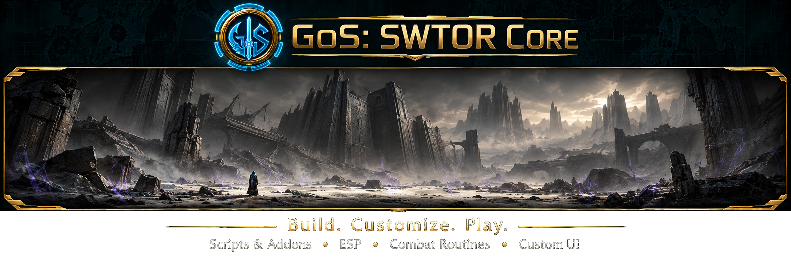

<figure class="gos-banner">
  
</figure>

# SWTOR botting and Lua scripting { #build-something-useful }

GoS-SWTOR / Lua developer documentation

Read the world. React to events. Create your own tools.
{ .gos-lead }

GoS-SWTOR supports SWTOR botting with Lua combat routines and addons. Install
published scripts and their declared shared dependencies through the Official
Script Library, or build your own overlays, event processors and gameplay
automation with the public Lua API.

[Use existing scripts](guides/getting-started.md){ .md-button .md-button--primary }
[Write your first script](guides/getting-started.md#install-and-run-your-first-script){ .md-button }
[Explore the API](api/index.md){ .md-button }

Visit the [GamingOnSteroids main site and community](https://gamingonsteroids.com/)
for project information and discussions.

- **Learn from maintained scripts**

    Time Supercharge, aim Holotraverse with the cursor, maintain Kolto Probe, predict who needs healing and track Sage procs.

    [Explore script recipes](examples/index.md)

- **Understand the data**

    Handles, snapshot lifetimes, effects, units and asynchronous commands.

    [Read the contracts](guides/runtime.md)

- **Go beyond API calls**

    Organize modules, store bounded histories and separate decisions from presentation.

    [Build your own modules](guides/module-authoring.md)

- **Keep scripts responsive**

    Bounded event processing, cached state and deliberate callback cadences.

    [Performance guide](guides/performance.md)

